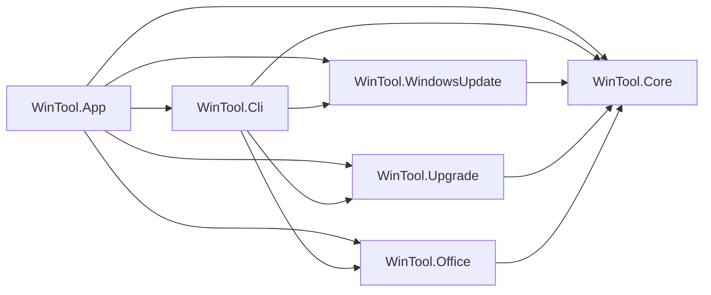

# Architecture

WinTool by PcNinja is a WPF application on .NET Framework 4.8 (see
[DECISIONS.md](DECISIONS.md)). This document describes the implemented
structure of the integrated maintenance candidate based on v1.0.2. Build and CI
evidence do not replace independent review and owner VM acceptance of the exact
candidate.

## Solution layout

```text
src/
  WinTool.App/              WPF executable: shell window, navigation, views,
                            view models, localization, elevation, CLI entry point
  WinTool.Core/             Shared services: logging, settings, atomic file
                            writes, operation locks, OS checks, app self-update
  WinTool.Cli/              Command parsing, output and dispatch to feature engines
  WinTool.WindowsUpdate/    Windows Update engine (WUA COM), schedule
                            (Task Scheduler), health check, reset
  WinTool.Upgrade/          Windows upgrade engine (ported from
                            PcNinja.Win11Upgrade.Core)
  WinTool.Office/           Office deployment engine (ported from Smart Office
                            Installer, uses the Office Deployment Tool)
  Shared/Polyfills/         Source-linked Framework compatibility helpers
tests/
  WinTool.Core.Tests/
  WinTool.Cli.Tests/         CLI parsing, output and dispatch tests
  WinTool.WindowsUpdate.Tests/
  WinTool.Upgrade.Tests/
  WinTool.Office.Tests/
  Fakes/                    Source-linked Windows Update fakes shared by tests
packaging/
  msi/                      WiX source, setup pages, license RTF
shared/                     Files shared byte-identical with other PcNinja tools
docs/
```

The build uses the .NET 10 SDK selected by `global.json`. Feature libraries and
all five test projects target `net48` and `net10.0-windows`; the shipped WPF
application remains x64 .NET Framework 4.8. CLI tests live in their own project
and share `tests/Fakes/WindowsUpdateFakes.cs` with the Windows Update tests.

### Dependency rules



- Feature modules depend only on `WinTool.Core`, never on each other.
- Feature modules never reference WPF. They expose plain services that the
  GUI, the CLI and the tests all call the same way.
- App and CLI compose the feature services. CLI is a library inside the same
  executable, not a second program. `src/Shared/Polyfills` is source-linked
  compatibility code; it is distinct from the root `shared/` upstream files.
- Every machine-changing operation (install updates, upgrade, Office install
  or removal, Windows Update reset) runs under the machine-wide operation
  lock from `WinTool.Core`. Two such operations never overlap, whether they
  come from the GUI, the CLI, or a scheduled task.

### Packaging

`WinTool.App.csproj` embeds referenced assemblies and all three UI resource
sets, so the portable net48 executable runs as one file. `EmbeddedAssemblies`
loads library bytes in memory. There is no `packaging/portable/` project.

CI builds the regular app EXE, then the WiX MSI from that EXE, then rebuilds the
universal EXE carrying the MSI and its build-time SHA-256 (D-026). The MSI never
contains the universal EXE. `EmbeddedInstaller` extracts the MSI to a new
temporary folder, checks the embedded hash and invokes Windows Installer when
installation is chosen. D-029 records the owner's narrow clarification of
D-009 for this D-026 payload; the original D-009 entry remains intact.

## Navigation

Each tool is one screen that holds everything needed to operate it, so the
user never switches tabs to work with one tool. The Dashboard is read-only:
it summarizes what each tool sees on this computer and links to the tool
(owner decisions, 2026-11-06). The Drivers page from WinUpdate V2 is not
included.

```text
Dashboard          Summary only: pending updates and restart, Windows
                   version and upgrade path, installed Office edition and
                   its apps, computer details (name, user, LAN/WAN IP, CPU,
                   memory, storage, graphics, board, BIOS, TPM, last
                   restart), WinTool status
──────────
Windows Update     Status and restart state, available updates, health and
                   maintenance actions, and the schedule (edited in place)
Windows Upgrade    This computer, installation source, Windows image,
                   options, validate and start. ISO help: find a
                   matching ISO, PcNinja ISO downloads, Microsoft page
Office             Product family, mode (install / offline package /
                   remove), channel, apps, languages, summary
──────────
Logs               Lazy-loaded, filtered by tool
Settings           Theme, language, application updates, about
Useful Links       help.pcninja.pro, PcNinja free tools (Driver Updater,
                   Windows & Office Activation, www.pcninja.pro, this
                   repository), shared file password, manufacturer
                   sources (Dell, HP, Lenovo, ASUS; reference only)
```

A Help link to help.pcninja.pro is always visible in the sidebar footer.

Footer: installed version, latest version, **Check Tool Update**.

## Command line

One CLI grammar for all modules, which the scheduled task also uses:

```text
WinTool-by-PcNinja.exe <area> <command> [options] [--json]

WinTool-by-PcNinja.exe update scan
WinTool-by-PcNinja.exe update run [--windows] [--optional] [--drivers] [--firmware]
WinTool-by-PcNinja.exe update reset --confirm
WinTool-by-PcNinja.exe schedule show
WinTool-by-PcNinja.exe schedule set --enable --frequency Monthly --month-day 15 --time 03:00
WinTool-by-PcNinja.exe schedule remove
WinTool-by-PcNinja.exe upgrade status | scan | validate | run
WinTool-by-PcNinja.exe office status | config | install | package | remove | tool-check
WinTool-by-PcNinja.exe app-update check | install
WinTool-by-PcNinja.exe status [--json]
WinTool-by-PcNinja.exe logs collect
```

Complete syntax and confirmation requirements are in [CLI.md](CLI.md).
Exit codes are documented per command. `--json` output is stable and
versioned, so scripts can depend on it.

## Cross-cutting rules carried over from the existing tools

- UTF-8 everywhere. Update titles in Hebrew and other scripts must never be
  garbled (WinUpdate V2.2.7).
- Configuration and state files are written atomically: write a temporary
  file, then replace (WinUpdate V2.2.6).
- Self-update downloads to a temporary file, verifies SHA-256 and the expected
  file name, and only then replaces anything (WinUpdate V2.2.6, Upgrade Tool,
  Smart Office).
- GUI single instance per logon session; CLI is never blocked by an open
  window (`shared/README.md`).
- Theme follows Windows dark/light mode live; colors come only from theme
  tokens (D-012).
- No hidden console window and no reliance on an attached console in the GUI
  (WinUpdate V2.2.8 incident).
